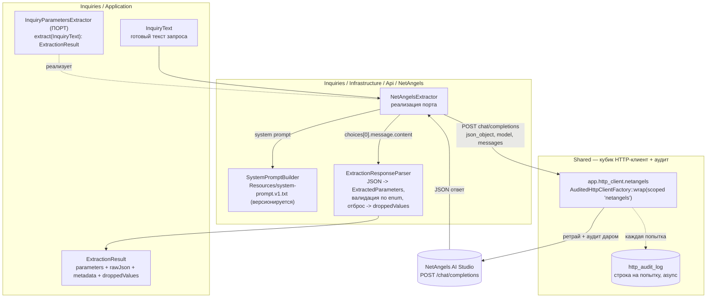

# Схема: Inquiries — экстрактор параметров (план 1)

## Структура и поток (flowchart)



## Что внутри

- **Порт** `InquiryParametersExtractor` — говорит «текст → параметры», не «модель». Сегодня за ним NetAngels; завтра перед ним кэш/шаблоны (план 5), потребители не меняются.
- **NetAngelsExtractor** шлёт `POST chat/completions` (`response_format: json_object`, модель из env) через **наш аудируемый клиент** — ретрай 5xx/сети и запись каждой попытки в `http_audit_log` получаются бесплатно.
- **SystemPromptBuilder** — обкатанный системный промпт (с `specifiedCoatings`), версионируется в Resources.
- **ExtractionResponseParser** — JSON модели → `ExtractedParameters`; значения вне enum проекта (`Substrate`/`EnvironmentType`/`ComplianceStandard`/`IsoCorrosivityCategory`/`IsoDurability`/`ThermalEnvironment`) отбрасываются в null/[] и попадают в `droppedValues`.
- **ExtractionResult** несёт параметры + сырой JSON (для разбора ошибок) + метаданные (модель, версия промпта, токены, время, `strategy="llm:netangels"`) + отброшенное.

## Границы

- Сетевые/HTTP-ошибки **пробрасываются** — их ловит движок (план 3), превращая в доменный «ошибка связи с моделью».
- Резолв `substances`/`specifiedCoatings` в id и сборка `CoatingSystemsFilter` — **не тут**, это план 2.
```
