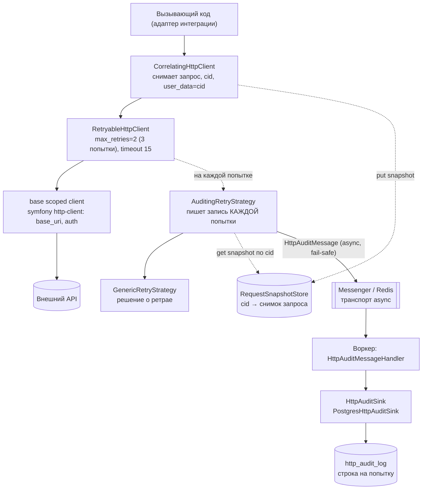

# Схема: общий HTTP-клиент + аудит исходящих

## Слои и потоки (flowchart)



## Поток одного запроса: провал → успех (sequence)

```mermaid
sequenceDiagram
    autonumber
    participant C as Вызывающий код
    participant Cor as CorrelatingHttpClient
    participant Store as RequestSnapshotStore
    participant R as RetryableHttpClient
    participant S as AuditingRetryStrategy
    participant B as base client
    participant API as Внешний API
    participant MB as Messenger async
    participant W as Воркер + Postgres sink
    participant DB as http_audit_log

    C->>Cor: request(POST, url, json, headers)
    Cor->>Cor: cid = uuid; снимок запроса (redact + cap)
    Cor->>Store: put(cid, snapshot)
    Cor->>R: request(..., user_data=cid)

    rect rgb(245, 235, 235)
    Note over R,API: Попытка #1
    R->>B: request
    B->>API: POST
    API-->>B: 500
    R->>S: shouldRetry(ctx, null)
    S-->>R: null  (добуферить тело)
    R->>S: shouldRetry(ctx, "err")
    S->>Store: get(cid)
    S-->>MB: HttpAuditMessage attempt=1 status=500
    S-->>R: true  (ретрай)
    end

    rect rgb(235, 245, 235)
    Note over R,API: Попытка #2 (после delay)
    R->>B: request
    B->>API: POST
    API-->>B: 200
    R->>S: shouldRetry(ctx, null)
    S-->>R: null
    R->>S: shouldRetry(ctx, "ok")
    S->>Store: get(cid) + forget(cid)
    S-->>MB: HttpAuditMessage attempt=2 status=200
    S-->>R: false  (стоп)
    end

    R-->>C: ответ 200

    Note over MB,DB: вне пути вызова (async)
    MB->>W: доставка сообщения
    W->>DB: INSERT (одна строка на попытку)
```

## Что гарантирует

- Одна строка в `http_audit_log` на КАЖДУЮ попытку, связаны `correlation_id`.
- Тело снимается и у успеха: стратегия возвращает `null` на первый вызов → RetryableHttpClient добуферивает тело.
- Fail-safe: отправка сообщения и съёмка в `try/catch` — сбой аудита не ломает и не тормозит реальный вызов.
- Секреты (`Authorization`/ключи/query) вырезаны, тела обрезаны по лимиту.
- Настройки — строками в `config/packages/http_client.yaml`.
- Сток сменный: `HttpAuditSink` → Postgres сейчас, ClickHouse потом подменой алиаса.
```
